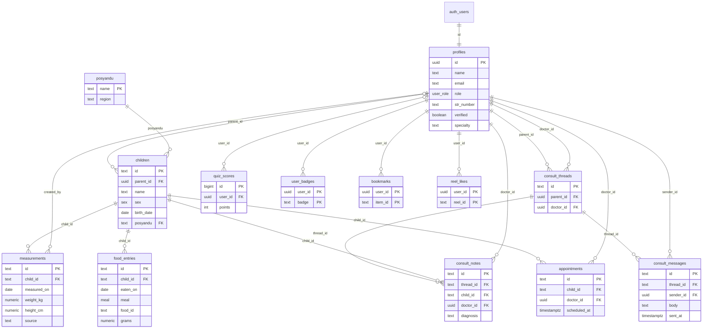

# Skema Database GroWell

Dokumen ini menjelaskan struktur database GroWell **prototype v0.3**. Sumber kebenarannya adalah berkas migrasi
[`supabase/migrations/20261027000001_skema_growell.sql`](../supabase/migrations/20261027000001_skema_growell.sql).
Bila migrasi berubah, dokumen ini ikut diperbarui.

| Item | Keterangan |
| --- | --- |
| Basis data | PostgreSQL 17 di Supabase (lokal lewat Supabase CLI + Docker) |
| Skema | `public`, ditambah `auth.users` milik Supabase Auth |
| Isi | 13 tabel, 1 view, 3 tipe enum, 7 fungsi bantu, 4 trigger, kebijakan RLS per peran, publikasi Realtime |
| Acuan kebutuhan | SRS Vizion 23-002 GroWell (kode ER), Project Charter GroWell final |
| Uji hak akses | [`supabase/tests/database/rls_test.sql`](../supabase/tests/database/rls_test.sql), 20 uji pgTAP |

---

## Daftar isi
1. [Prinsip desain](#prinsip-desain)
2. [Diagram relasi](#diagram-relasi)
3. [Tipe enum](#tipe-enum)
4. [Tabel](#tabel)
5. [View](#view)
6. [Fungsi bantu](#fungsi-bantu)
7. [Trigger dan validasi](#trigger-dan-validasi)
8. [Hak akses (Row Level Security)](#hak-akses-row-level-security)
9. [Realtime](#realtime)
10. [Pemetaan ke kebutuhan teknis SRS](#pemetaan-ke-kebutuhan-teknis-srs)
11. [Data yang tidak disimpan di database](#data-yang-tidak-disimpan-di-database)
12. [Catatan dan hal yang perlu ditindaklanjuti](#catatan-dan-hal-yang-perlu-ditindaklanjuti)

---

## Prinsip desain

- **Database menyimpan data mentah, aplikasi menghitung.** Z-score, status gizi, dan kebutuhan kalori dihitung di aplikasi
  (`lib/core/`) dari tabel acuan WHO dan AKG. Database hanya menyimpan berat, tinggi, tanggal ukur, dan catatan makan.
  Dengan begitu, perubahan tabel acuan tidak memerlukan migrasi data.
- **Hak akses dijaga di database, bukan hanya di aplikasi.** Setiap tabel memakai Row Level Security (RLS), jadi permintaan
  yang melewati aplikasi pun tetap dibatasi sesuai peran.
- **Peran dan verifikasi tidak bisa diatur sendiri.** Profil dibuat oleh trigger saat registrasi. Peran `admin` dan status
  verifikasi STR hanya bisa diubah admin.
- **Validasi ganda.** Aplikasi memvalidasi input, lalu database menolak lagi data yang tidak wajar lewat `CHECK` dan trigger
  (ER-6.2).
- **Tanggal mengikuti WIB.** Fungsi `today_wib()` dipakai agar input pagi hari tidak dianggap tanggal masa depan.

---

## Diagram relasi

Ringkasnya:
- Satu **orang tua** bisa memiliki banyak **anak**, dan setiap anak terdaftar di satu **posyandu**.
- Satu anak memiliki banyak **pengukuran** (bulanan) dan banyak **catatan makan**.
- **Konsultasi** berbentuk satu percakapan per pasangan orang tua–nakes. Percakapan berisi **pesan**, dan nakes bisa
  menulis **catatan konsultasi** untuk anak tertentu serta membuat **jadwal kontrol**.
- **Skor kuis**, **lencana**, **simpanan konten**, dan **suka reels** melekat ke pengguna.

---

## Tipe enum

| Tipe | Nilai | Dipakai di |
| --- | --- | --- |
| `user_role` | `parent` (orang tua), `teen` (remaja), `health` (tenaga kesehatan), `admin` | `profiles.role` |
| `sex` | `male`, `female` | `children.sex` |
| `meal` | `pagi`, `siang`, `malam`, `selingan` | `food_entries.meal` |

---

## Tabel

Kolom `id` bertipe `text` diisi otomatis dengan UUID (`gen_random_uuid()::text`). Data contoh di `seed.sql` memakai id yang
mudah dibaca, misalnya `c_abiyu`.

### Akun dan peran

#### `profiles`
Profil setiap pengguna. Dibuat otomatis oleh trigger `on_auth_user_created` saat registrasi. Nakes baru aktif setelah STR
diverifikasi admin.

| Kolom | Tipe | Batasan | Keterangan |
| --- | --- | --- | --- |
| `id` | uuid | PK, FK → `auth.users.id`, hapus berantai | Sama dengan id akun Supabase Auth |
| `name` | text | wajib | Nama tampilan |
| `email` | text | wajib | Disalin dari akun Auth |
| `role` | `user_role` | wajib, bawaan `parent` | Peran pengguna |
| `str_number` | text | opsional | Nomor STR, khusus nakes |
| `verified` | boolean | wajib, bawaan `false` | Status verifikasi STR oleh admin |
| `title` | text | opsional | Gelar/jabatan nakes |
| `specialty` | text | opsional | Spesialisasi nakes; bawaan "Dokter Umum" saat registrasi nakes |
| `experience_years` | int | opsional | Lama pengalaman nakes |
| `workplace` | text | opsional | Tempat praktik nakes |
| `created_at` | timestamptz | bawaan `now()` | Waktu dibuat |

### Data referensi

#### `posyandu`
Daftar posyandu untuk mendaftarkan anak dan memfilter dashboard nakes.

| Kolom | Tipe | Batasan | Keterangan |
| --- | --- | --- | --- |
| `name` | text | PK | Nama posyandu |
| `region` | text | wajib | Wilayah (kelurahan/desa) |

Isi awal tabel ini ditulis langsung di berkas migrasi: Posyandu Melati (Kel. Kalideres) dan Posyandu Mawar (Kel. Cilandak).
Lihat [catatan nomor 1](#catatan-dan-hal-yang-perlu-ditindaklanjuti).

### Baduta dan pengukuran

#### `children`
Profil anak baduta (0–24 bulan) milik orang tua.

| Kolom | Tipe | Batasan | Keterangan |
| --- | --- | --- | --- |
| `id` | text | PK | |
| `parent_id` | uuid | wajib, FK → `profiles.id`, hapus berantai | Orang tua pemilik |
| `name` | text | wajib, tidak boleh kosong | Nama anak |
| `sex` | `sex` | wajib | Jenis kelamin, dipakai untuk tabel acuan WHO |
| `birth_date` | date | wajib | Divalidasi trigger `validate_child` |
| `posyandu` | text | wajib, FK → `posyandu.name` | Posyandu tempat anak terdaftar |
| `created_at` | timestamptz | bawaan `now()` | |

Indeks: `(parent_id)`.

#### `measurements`
Riwayat pengukuran berat dan panjang/tinggi badan. Z-score dihitung di aplikasi dari kolom-kolom ini.

| Kolom | Tipe | Batasan | Keterangan |
| --- | --- | --- | --- |
| `id` | text | PK | |
| `child_id` | text | wajib, FK → `children.id`, hapus berantai | |
| `measured_on` | date | wajib | Divalidasi trigger `validate_measurement` |
| `weight_kg` | numeric(5,2) | wajib, 1–30 | Berat badan (kg) |
| `height_cm` | numeric(5,1) | wajib, 40–120 | Panjang/tinggi badan (cm) |
| `source` | text | wajib, `manual` atau `foto_simulasi` | Asal data |
| `created_by` | uuid | FK → `profiles.id`, bawaan `auth.uid()` | Pengguna yang mencatat |
| `created_at` | timestamptz | bawaan `now()` | |

Indeks: `(child_id, measured_on)` untuk mengambil riwayat dan menggambar grafik (ER-1.2).

### Gizi harian

#### `food_entries`
Catatan makan harian anak.

| Kolom | Tipe | Batasan | Keterangan |
| --- | --- | --- | --- |
| `id` | text | PK | |
| `child_id` | text | wajib, FK → `children.id`, hapus berantai | |
| `eaten_on` | date | wajib | Tanggal makan |
| `meal` | `meal` | wajib | Waktu makan |
| `food_id` | text | wajib | Id bahan makanan di katalog aplikasi (`lib/data/foods.dart`), bukan FK |
| `grams` | numeric(6,1) | wajib, > 0 dan ≤ 1000 | Porsi (gram) |
| `created_at` | timestamptz | bawaan `now()` | |

Indeks: `(child_id, eaten_on)` untuk rekap harian dan mingguan.

### Konsultasi

#### `consult_threads`
Satu percakapan untuk setiap pasangan orang tua dan nakes.

| Kolom | Tipe | Batasan | Keterangan |
| --- | --- | --- | --- |
| `id` | text | PK | |
| `parent_id` | uuid | wajib, FK → `profiles.id` | Orang tua |
| `doctor_id` | uuid | wajib, FK → `profiles.id` | Nakes yang dipilih |
| `created_at` | timestamptz | bawaan `now()` | |

Unik: `(parent_id, doctor_id)`.

#### `consult_messages`
Pesan dalam percakapan.

| Kolom | Tipe | Batasan | Keterangan |
| --- | --- | --- | --- |
| `id` | text | PK | |
| `thread_id` | text | wajib, FK → `consult_threads.id`, hapus berantai | |
| `sender_id` | uuid | wajib, FK → `profiles.id`, bawaan `auth.uid()` | Pengirim |
| `body` | text | wajib, tidak boleh kosong | Isi pesan |
| `sent_at` | timestamptz | bawaan `now()` | Waktu kirim |

Indeks: `(thread_id, sent_at)`.

#### `consult_notes`
Catatan konsultasi yang ditulis nakes untuk seorang anak. Bisa diunduh sebagai PDF di aplikasi.

| Kolom | Tipe | Batasan | Keterangan |
| --- | --- | --- | --- |
| `id` | text | PK | |
| `thread_id` | text | wajib, FK → `consult_threads.id` | |
| `child_id` | text | wajib, FK → `children.id` | Anak yang dibahas |
| `doctor_id` | uuid | wajib, FK → `profiles.id`, bawaan `auth.uid()` | Nakes penulis |
| `title` | text | wajib, tidak boleh kosong | Judul catatan |
| `keterangan` | text | bawaan `''` | Keterangan keluhan |
| `diagnosis` | text | wajib, tidak boleh kosong | Kesimpulan nakes |
| `anjuran` | text | bawaan `''` | Anjuran |
| `catatan` | text | bawaan `''` | Catatan tambahan |
| `created_at` | timestamptz | bawaan `now()` | |

#### `appointments`
Jadwal kontrol yang dibuat nakes.

| Kolom | Tipe | Batasan | Keterangan |
| --- | --- | --- | --- |
| `id` | text | PK | |
| `child_id` | text | wajib, FK → `children.id` | |
| `doctor_id` | uuid | wajib, FK → `profiles.id`, bawaan `auth.uid()` | |
| `scheduled_at` | timestamptz | wajib | Waktu kontrol |
| `created_at` | timestamptz | bawaan `now()` | |

### Kuis

Tabel kuis sudah ada di prototype. Menurut Project Charter, kuis multiplayer real-time termasuk **pasca-MVP**.

#### `quiz_scores`

| Kolom | Tipe | Batasan | Keterangan |
| --- | --- | --- | --- |
| `id` | bigint | PK, identity | |
| `user_id` | uuid | FK → `profiles.id`, boleh kosong | Kosong untuk pemain contoh/bot |
| `display_name` | text | wajib | Nama di papan skor |
| `points` | int | wajib, ≥ 0 | Poin |
| `correct` | int | bawaan 0 | Jumlah jawaban benar |
| `total` | int | bawaan 0 | Jumlah soal |
| `played_at` | timestamptz | bawaan `now()` | |

#### `user_badges`

| Kolom | Tipe | Batasan | Keterangan |
| --- | --- | --- | --- |
| `user_id` | uuid | PK, FK → `profiles.id` | |
| `badge` | text | PK | Kode lencana |
| `earned_at` | timestamptz | bawaan `now()` | |

### Preferensi konten

#### `bookmarks`
Konten edukasi yang disimpan pengguna. PK `(user_id, item_id)`; `item_id` merujuk ke konten di `lib/data/content.dart`.

#### `reel_likes`
Reels yang disukai pengguna. PK `(user_id, reel_id)`.

---

## View

### `weekly_leaderboard`
Papan skor minggu berjalan (ER-7.5): menjumlahkan `quiz_scores.points` per `display_name` sejak awal minggu.
Dibuat dengan `security_invoker = true`, jadi tetap tunduk pada RLS tabel `quiz_scores`.

---

## Fungsi bantu

Fungsi `SECURITY DEFINER` dipakai agar kebijakan RLS bisa membaca `profiles` tanpa terjadi rekursi RLS.

| Fungsi | Hasil | Kegunaan |
| --- | --- | --- |
| `today_wib()` | date | Tanggal hari ini menurut WIB |
| `my_role()` | `user_role` | Peran pengguna yang sedang login |
| `is_admin()` | boolean | Apakah pengguna admin |
| `is_verified_health()` | boolean | Apakah pengguna nakes terverifikasi |
| `is_verified_health_user(uid)` | boolean | Apakah `uid` nakes terverifikasi; dipakai saat membuka percakapan |
| `is_parent_of(child)` | boolean | Apakah pengguna orang tua dari anak tersebut |
| `is_thread_member(thread)` | boolean | Apakah pengguna peserta percakapan tersebut |

---

## Trigger dan validasi

| Trigger | Tabel | Waktu | Aturan |
| --- | --- | --- | --- |
| `on_auth_user_created` → `handle_new_user()` | `auth.users` | setelah insert | Membuat baris `profiles` dari metadata registrasi. Peran selain `parent`, `teen`, `health` diubah menjadi `parent`, jadi tidak ada yang bisa mendaftar sebagai admin. Status verifikasi selalu `false`. |
| `protect_profile_columns` | `profiles` | sebelum update | Lewat API, hanya admin yang boleh mengubah `role`, `verified`, `id`, atau `email`. Skrip SQL langsung (seed) tetap diizinkan. |
| `validate_child` | `children` | sebelum insert/update | Tanggal lahir tidak boleh di masa depan. Saat insert, umur anak maksimal 731 hari (± 24 bulan). |
| `validate_measurement` | `measurements` | sebelum insert/update | Tanggal ukur tidak boleh di masa depan, tidak boleh sebelum tanggal lahir, dan umur saat diukur maksimal 731 hari. |

Batasan `CHECK` lain: berat 1–30 kg, tinggi 40–120 cm, porsi makan 0–1000 gram, nama anak/judul/diagnosis/isi pesan tidak
boleh kosong, poin kuis tidak negatif. Pelanggaran dikembalikan dengan kode `23514` dan pesan berbahasa Indonesia.

---

## Hak akses (Row Level Security)

RLS aktif di ke-13 tabel. Pengguna yang belum login (`anon`) tidak mendapat akses ke tabel mana pun.

Keterangan: **B** = baca, **T** = tambah, **U** = ubah, **H** = hapus, – = tidak ada akses.

| Tabel | Orang tua | Remaja | Nakes terverifikasi | Nakes belum terverifikasi | Admin |
| --- | --- | --- | --- | --- | --- |
| `profiles` | B: diri sendiri, nakes terverifikasi, lawan bicara konsultasi · U: diri sendiri | B: diri sendiri, nakes terverifikasi · U: diri sendiri | B: semua · U: diri sendiri | B: diri sendiri, nakes terverifikasi · U: diri sendiri | B, U: semua, termasuk peran dan verifikasi STR |
| `posyandu` | B | B | B | B | B |
| `children` | B, T, U, H: anak sendiri | – | B: semua | – | B: semua |
| `measurements` | B, T, H: anak sendiri | – | B: semua | – | B: semua |
| `food_entries` | B, T, H: anak sendiri | – | B: semua | – | B: semua |
| `consult_threads` | B: milik sendiri · T: dengan nakes terverifikasi | – | B: yang ditangani | – | – |
| `consult_messages` | B, T: di percakapan sendiri | – | B, T: di percakapan yang ditangani | Tidak bisa mengirim | – |
| `consult_notes` | B: di percakapan sendiri | – | B: di percakapan yang ditangani · T: untuk anak dari orang tua di percakapannya | – | – |
| `appointments` | B: anak sendiri | – | B: yang dibuatnya · T | – | – |
| `quiz_scores` | B: semua · T: skor sendiri | B: semua · T: skor sendiri | B: semua | B: semua | B: semua |
| `user_badges` | B, T: milik sendiri | B, T: milik sendiri | B, T: milik sendiri | B, T: milik sendiri | B, T: milik sendiri |
| `bookmarks`, `reel_likes` | Semua operasi: milik sendiri | Semua operasi: milik sendiri | Semua operasi: milik sendiri | Semua operasi: milik sendiri | Semua operasi: milik sendiri |

Hal penting yang dijaga RLS dan sudah diuji di `rls_test.sql`:
- Orang tua hanya melihat anaknya sendiri, dan remaja tidak melihat data baduta sama sekali.
- Hanya orang tua pemilik percakapan atau nakes **terverifikasi** yang ditunjuk yang bisa mengirim pesan konsultasi.
  Remaja dan nakes yang belum terverifikasi ditolak (ER-4.2, TC-19).
- Nakes yang belum terverifikasi tidak bisa membuka dashboard baduta.
- Pengguna biasa tidak bisa menjadikan dirinya admin atau memverifikasi STR sendiri.
- Admin mengelola verifikasi STR, tetapi tidak bisa membaca isi percakapan konsultasi.

Tidak ada kebijakan `UPDATE` untuk `measurements` dan `food_entries`. Koreksi data dilakukan dengan menghapus lalu
mencatat ulang.

---

## Realtime

Tabel berikut dipublikasikan ke `supabase_realtime`, sehingga perubahan langsung tampil di aplikasi (tetap disaring RLS):
`profiles`, `children`, `measurements`, `consult_threads`, `consult_messages`, `consult_notes`, `appointments`.

Fungsi utamanya adalah chat konsultasi real-time (ER-4.1) dan pembaruan dashboard nakes.

---

## Pemetaan ke kebutuhan teknis SRS

| ER | Kebutuhan (ringkas) | Bagian database | Keterangan |
| --- | --- | --- | --- |
| ER-1.1 | Hitung z-score TB/U, BB/U, BB/TB | `measurements`, `children` (`sex`, `birth_date`) | Perhitungan di aplikasi (`lib/core/zscore.dart`) |
| ER-1.2 | Riwayat pengukuran dan grafik | `measurements` + indeks `(child_id, measured_on)` | |
| ER-1.3 | Peringatan risiko stunting | `measurements` | Aturan di aplikasi (`lib/core/status.dart`) |
| ER-1.4 | Pengingat jadwal pemeriksaan | `appointments` (jadwal kontrol dari nakes) | Notifikasi terjadwal ke perangkat belum ada |
| ER-2.1 | Catat makanan harian dan statistik | `food_entries` + indeks `(child_id, eaten_on)` | Nilai gizi dari katalog di aplikasi |
| ER-2.2 | Rekomendasi makanan berprotein | – | Dihitung di aplikasi |
| ER-2.3 | Kebutuhan kalori sesuai AKG | `children` (umur) | Tabel AKG di aplikasi (`lib/core/nutrition.dart`) |
| ER-3.1 | Konten edukasi | `bookmarks`, `reel_likes` | Isi konten disimpan di aplikasi, bukan database |
| ER-4.1 | Pesan konsultasi ≤ 2 detik | `consult_messages` + Realtime | |
| ER-4.2 | Jawaban medis hanya nakes terverifikasi | RLS `consult_messages`, `consult_notes`, `is_verified_health()` | Diuji di `rls_test.sql` |
| ER-4.3 | Daftar dokter, spesialisasi, rekap per dokter | `profiles` (`specialty`, `title`, dll.), `consult_threads`, `consult_notes` | |
| ER-5.1 | Dashboard rekap status gizi per wilayah/posyandu | `children`, `measurements`, `posyandu` | Status dihitung di aplikasi |
| ER-5.2 | Ekspor laporan CSV dan PDF | – | Dibuat di aplikasi; saat ini baru CSV |
| ER-6.2 | Cegah input tidak wajar | `CHECK`, `validate_child`, `validate_measurement` | |
| ER-6.5 | Login, pemulihan akun, peran, verifikasi STR | `auth.users`, `profiles`, `handle_new_user`, `protect_profile_columns`, RLS | Kata sandi di-hash oleh Supabase Auth |
| ER-7.x | Kuis multiplayer, leaderboard, lencana | `quiz_scores`, `user_badges`, `weekly_leaderboard` | Pasca-MVP menurut charter |

---

## Data yang tidak disimpan di database

| Data | Lokasi sekarang | Dampak |
| --- | --- | --- |
| Tabel acuan WHO (LMS) | `lib/data/who_lms.dart` | Z-score dihitung di perangkat |
| Katalog bahan makanan dan resep MPASI | `lib/data/foods.dart`, `lib/data/recipes.dart` | `food_entries.food_id` tidak bisa dicek dengan FK |
| Konten edukasi (artikel dan reels) | `lib/data/content.dart` | Status "ditinjau tenaga kesehatan" (ER-3.1) belum tercatat |
| Bank soal kuis | `lib/data/quiz_bank.dart` | Pasca-MVP |
| Foto anak dan dokumen STR | Belum diunggah ke Supabase Storage | Unggah STR masih simulasi |
| Token notifikasi perangkat | Belum ada | Dibutuhkan bila memakai Firebase Cloud Messaging |

---

## Catatan dan hal yang perlu ditindaklanjuti

Catatan berikut adalah temuan dari membaca migrasi. Belum ada yang diubah.

1. **Data posyandu masih contoh dari Jakarta.** Posyandu Melati (Kalideres) dan Posyandu Mawar (Cilandak) ditulis langsung
   di berkas migrasi, bukan di `seed.sql`, sehingga ikut terkirim saat `supabase db push`. Daftar posyandu dan wilayah yang
   sebenarnya perlu diminta ke Dinas Kesehatan Kabupaten Natuna sebelum uji coba.
2. **Nakes terverifikasi bisa melihat semua anak.** Belum ada relasi antara nakes dan posyandu binaannya, padahal ER-5.1
   menyebut "baduta binaan" dan halaman dashboard menulis bahwa daftar akan dibatasi ke posyandu binaan. Untuk itu
   dibutuhkan tabel penghubung nakes–posyandu dan penyesuaian kebijakan RLS.
3. **Data simulasi foto ikut tersimpan sebagai pengukuran.** Hasil estimasi foto disimpan di `measurements` dengan
   `source = 'foto_simulasi'`, sehingga ikut dihitung di z-score, peringatan stunting, dan dashboard nakes. Sesuai keputusan
   tim, fitur ini di luar lingkup MVP. Sebelum uji coba, fitur sebaiknya disembunyikan atau data dengan sumber ini
   dikecualikan dari dashboard.
4. **Jadwal kontrol belum dicek keterkaitannya.** Kebijakan insert `appointments` hanya memeriksa bahwa pembuatnya nakes
   terverifikasi, belum memeriksa bahwa anak tersebut milik orang tua di percakapannya.
5. **Nakes terverifikasi bisa membaca semua profil**, termasuk email orang tua. Dashboard memang butuh nama, tetapi demi
   prinsip data seminimal mungkin (risiko di charter), kolom yang terlihat bisa dibatasi, misalnya lewat view.
6. **Ekspor PDF dashboard belum ada** (ER-5.2). Yang sudah ada adalah ekspor CSV dashboard dan PDF catatan konsultasi.
7. **Pengingat jadwal ke perangkat belum ada** (ER-1.4). Butuh notifikasi lokal atau FCM di versi Android.
8. **Lingkar kepala tidak disimpan.** Ini sudah sesuai charter dan SRS yang hanya mewajibkan BB dan TB. Laporan progress
   masih menyebut lingkar kepala.
